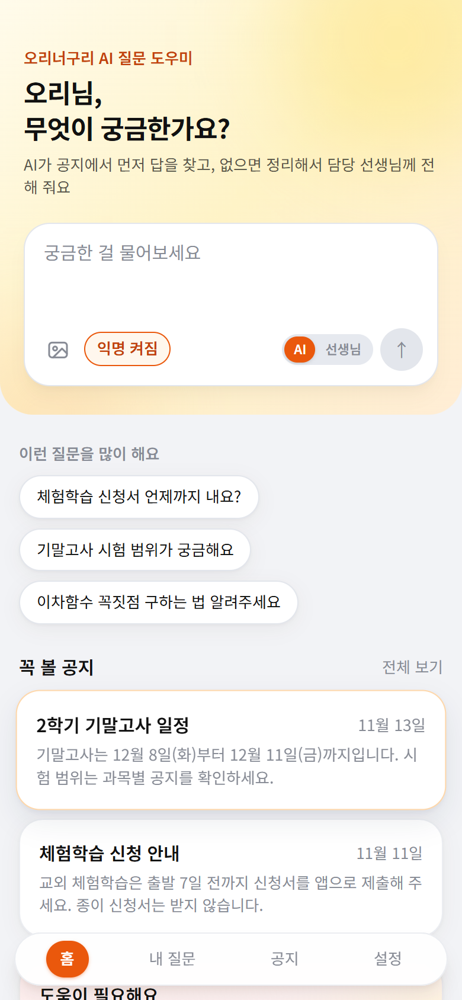
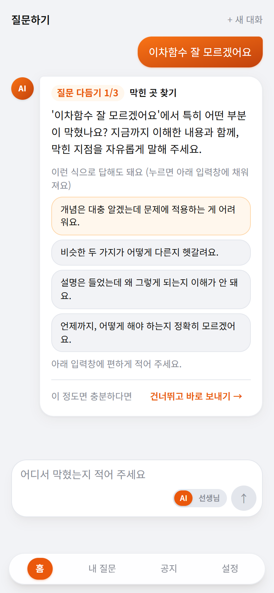
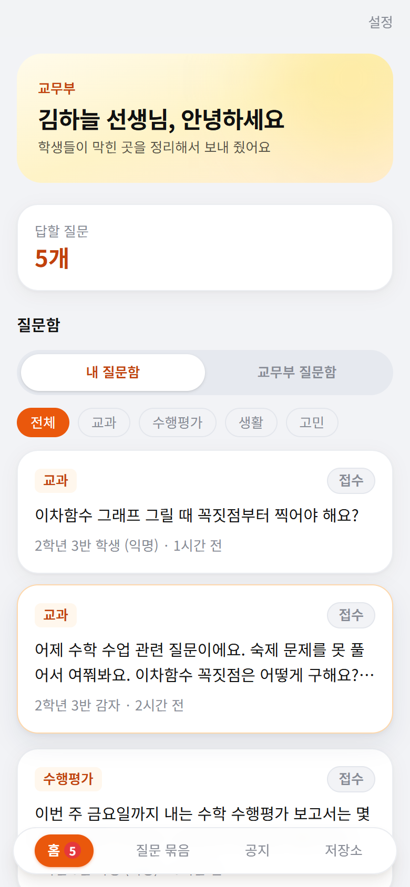
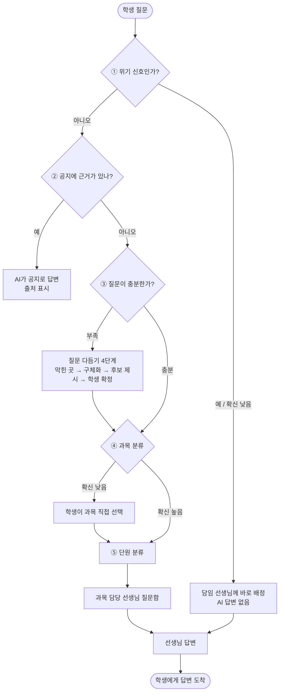
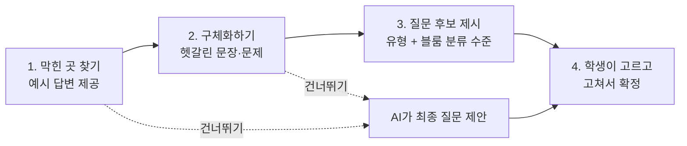
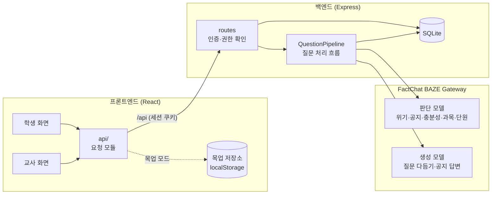

<p align="center">
  
</p>

<h1 align="center">오리너구리</h1>

<p align="center"><b>좋은 질문을 만들도록 돕고, 학생이 어디서 막혔는지 선생님께 보여주는 AI 질문 도우미</b></p>

## 소개

AI가 답을 대신 주지 않고, **어디서 막혔는지 되물으며 학생이 스스로 좋은 질문을 만들도록 이끕니다.** 다듬어진 질문은 담당 선생님께 전달되어, 선생님은 **학생이 어느 부분을 모르는지** 바로 확인할 수 있습니다.

<table>
  <tr>
    <th>학생 홈</th>
    <th>AI와 질문 다듬기</th>
    <th>교사 홈</th>
  </tr>
  <tr>
    <td></td>
    <td></td>
    <td></td>
  </tr>
</table>

---

## 주요 기능

| 학생 | 교사 |
| --- | --- |
| **질문 다듬기**: AI가 막힌 곳을 되묻고 질문 후보를 제시, 학생이 고르고 고쳐서 완성 | **질문함**: 다듬어진 질문을 과목·단원과 함께 받음 |
| **공지 기반 즉시 답변**: 공지에 답이 있으면 출처와 함께 바로 답 | **질문 묶음**: 단원별로 반 전체가 막힌 곳 파악 |
| **사진 첨부**: 문제·자료 사진 최대 5장 | **답변하기**: 질문 상세에서 답을 작성해 학생에게 전송 |
| **내 질문**: 접수 → 전달됨 → 답변 완료 확인 | **위기 알림**: 고민·위기 질문이 홈 맨 위에 고정 |

---

## 질문 처리 흐름

학생이 질문을 보내면 백엔드의 질문 파이프라인이 아래 순서로 처리합니다. 판단마다 신뢰도 기준값이 있고, 기준에 못 미치면 안전한 쪽으로 처리합니다.



**질문 다듬기 4단계**



---

## 아키텍처



- **프론트엔드**는 모든 서버 요청을 `api/` 모듈로만 보냅니다. `VITE_API_MODE=mock`이면 같은 함수가 브라우저 목업 저장소를 써서 백엔드 없이도 동작합니다.
- **백엔드**는 세션 쿠키로 로그인을 확인하고, 학생은 자기 질문만, 교사는 배정된 질문만 볼 수 있습니다.
- **AI**는 두 모델로 나눴습니다. 판단 모델은 확률과 신뢰도를 숫자로 주는 분류를, 생성 모델은 문장 생성을 맡습니다. AI에는 학생 신원 없이 질문 내용과 공지만 전달되며, 판단 결과는 모두 DB에 기록됩니다.

| 구분 | 기술 |
| --- | --- |
| 프론트엔드 | React 19, TypeScript, Vite, Tailwind CSS v4, React Router v7 |
| 백엔드 | Node.js, Express 5, SQLite (better-sqlite3), express-session, multer, zod |
| AI | FactChat BAZE Gateway (판단 모델 + 생성 모델) |
| 문서 | Swagger UI (`/api-docs`) |

---

## 폴더 구조

```
ori_neoguri/
├── frontend/                  # 학생·교사 모바일 웹
│   ├── src/
│   │   ├── api/               # 서버 요청 (실제 백엔드 / 목업 공통 함수)
│   │   │   ├── backend/       #   백엔드 응답 타입과 변환(mappers)
│   │   │   └── mock/          #   목업 저장소와 시연 데이터
│   │   ├── components/        # 공용 UI (버튼, 카드, 입력창, 첨부, 뱃지)
│   │   ├── layouts/           # 공용 모바일 틀, 학생·교사 탭바
│   │   ├── pages/
│   │   │   ├── student/       #   홈(채팅), 내 질문, 공지, 설정
│   │   │   └── teacher/       #   홈(질문함), 질문 상세, 질문 묶음, 공지, 저장소
│   │   ├── session/           # 로그인 상태, 역할별 접근 제한
│   │   ├── lib/               # 날짜 표시, 폴링, 첨부 검사
│   │   ├── types/             # 질문·사용자 타입
│   │   ├── routes.ts          # 모든 화면 경로
│   │   └── index.css          # 디자인 토큰 (색·글자 크기)
│   └── flow.md                # 서비스 흐름과 화면 구조 설계
│
├── backend/                   # REST API 서버
│   ├── src/
│   │   ├── routes/            # auth, questions, teacher/questions, notices, subjects, files, users
│   │   ├── services/          # 질문 처리 파이프라인, 질문 다듬기, 첨부
│   │   ├── model-clients/     # BAZE 판단 모델·생성 모델 호출
│   │   ├── repositories/      # DB 읽기·쓰기
│   │   ├── db/                # 스키마, 초기화
│   │   └── middleware/        # 로그인·역할 확인, 업로드, 오류 처리
│   ├── db/seed.example.json   # 계정·과목·단원 시드 예시
│   └── test/                  # node:test 테스트
│
└── docs/                      # README 로고, 화면 캡처
```

---

## 실행 방법

Node.js 20 이상이 필요합니다. 명령은 PowerShell 기준입니다.

### 1. 백엔드

```powershell
cd backend
Copy-Item .env.example .env
Copy-Item db/seed.example.json db/seed.json
npm install
npm start
```

- `.env`의 `SESSION_SECRET`, `BAZE_API_KEY`, `GENERATION_MODEL`을 실제 값으로 바꿔 주세요.
- 서버 http://localhost:3000 · API 문서 http://localhost:3000/api-docs
- 자세한 설정은 [backend/README.md](backend/README.md)를 참고하세요.

### 2. 프론트엔드

```powershell
cd frontend
Copy-Item .env.example .env.local
npm install
npm run dev
```

- http://localhost:5173 에서 열립니다. `/api` 요청은 개발 서버가 백엔드로 넘겨줍니다.

### 백엔드 없이 시연하기

`frontend/.env.local`의 `VITE_API_MODE`를 `mock`으로 바꾸면 브라우저 목업 데이터로 실행됩니다. 탭 하나는 학생, 다른 탭은 교사로 열면 보낸 질문이 서로 바로 반영됩니다.

| 역할 | 입장 방법 |
| --- | --- |
| 학생 | 닉네임 + 반 코드 `DUCK23` 또는 `DUCK24` |
| 교사 | 교사 코드 `KIM23` 또는 `LEE24` |
