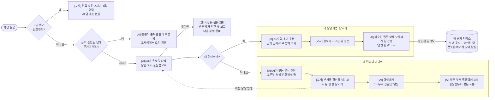
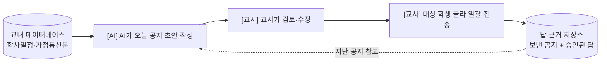
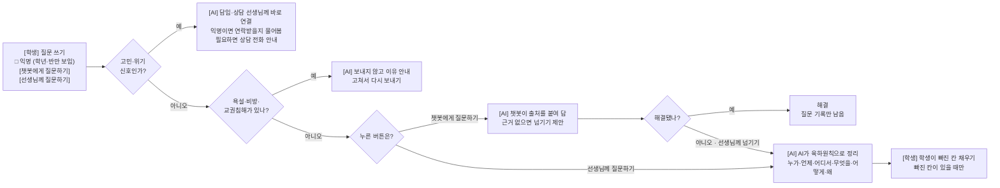
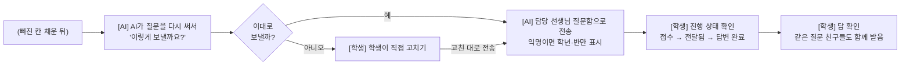

# 오리너구리 서비스 흐름과 화면 구조

> 원본: 팀 화이트보드 흐름도 (교사 관점, 학생 관점, 육하원칙 예시, 교사·학생 앱 화면 구조)
> 색 구분: **AI**가 하는 일 / **교사**가 하는 일 / **학생**이 하는 일

---

## 1. 교사 관점 흐름도

### 질문이 들어오면

- 바뀐 담당은 AI 분류 기준에 반영된다.

### 공지를 보낼 때

### 데이터 연결 (점선)

| 출발 | 도착 | 내용 |
|---|---|---|
| 답 근거 저장소 | "공지·승인된 답에 근거가 있나?" | 저장소에서 근거를 찾아 답함 |
| 교내 데이터베이스 | "공지·승인된 답에 근거가 있나?" | 학사일정으로 근거 판단 |
| 교내 데이터베이스 | AI 답 초안 추천 | 공지·일정 자료로 초안 작성 |
| 답 근거 저장소 | AI 답 초안 추천 | 근거 자료로 표시 |
| 답 근거 저장소 | AI 공지 초안 작성 | 지난 공지 참고 |
| 내 담당이 아니면 (부서 변경) | AI 유형 분류 | 바뀐 담당 반영 |

---

## 2. 학생 관점 흐름도

### 질문 보내기

### 보내고 답 받기

---

## 3. 예시: 육하원칙으로 다듬기

**원래 질문 (학생):** 체험학습 신청서 언제까지 내요?

**AI 정리:**

| 항목 | AI가 정리한 내용 |
|---|---|
| 누가 | 2학년 3반 학생 (익명) |
| 언제 | (빈칸) 학생이 채움 |
| 어디서 | (빈칸) 학생이 채움 |
| 무엇을 | 체험학습 신청서 제출 기한 |
| 어떻게 | (빈칸) 학생이 채움 |
| 왜 | (빈칸) 학생이 채움 |

**AI가 다시 쓴 질문:**
> 11월 20일 가족 여행으로 체험학습을 신청하려고 합니다. 신청서는 언제까지 내야 하고, 종이와 앱 중 어떤 방법으로 내면 되나요?

---

## 4. 교사용 앱 화면 구조

표시: **(AI)** AI가 채워 주는 부분 / **(교사)** 교사가 확인하고 누르는 버튼 / 표시 없음은 일반 화면 요소

- **홈**
  - (AI) 위기 알림 — 맨 위에 고정
  - 오늘 답할 질문 수
  - (AI) 오늘 보낼 공지 초안
  - (AI) 많이 나온 질문 TOP 3
- **질문함**
  - 내 질문함 · 부서 질문함
  - 유형·우선순위로 거르기 — 교과·수행평가·생활·고민
  - (AI) 질문 상세 — 육하원칙으로 정리된 카드, 익명이면 학년·반만
    - (AI) AI 답 초안과 근거
    - (교사) 고쳐서 승인·보내기
    - (교사) 다른 부서로 넘기기 — AI 추천 부서·사유 한 줄
  - 넘긴 질문 (원본 이미지에서 일부 잘림)
- **질문 묶음**
  - (AI) 개념별 묶음과 학생 수
  - 반·과목·기간으로 보기
  - (AI) 다음 수업 보충 설명 초안
- **공지**
  - (AI) AI 공지 초안 — 학사일정·가정통신문 기반
  - (교사) 검토·수정 후 대상 골라 일괄 전송
  - 보낸 공지 목록
- **답 근거 저장소**
  - 보낸 공지
  - 승인된 답
  - (교사) 수업 자료·루브릭 올리기
- **설정**
  - 담당 과목·반·부서 — 질문이 오는 기준
  - 질문 받는 시간
  - 위기 신호 반응 사항
  - 알림 설정

---

## 5. 학생용 앱 화면 구조

표시: **(AI)** AI가 채워 주는 부분 / **(학생)** 학생이 쓰거나 누르는 부분 / 표시 없음은 일반 화면 요소

- **홈**
  - 오늘 꼭 볼 공지
  - 새로 온 답 알림
  - (학생) 도움이 필요해요 — 상담 선생님 연결
- **질문하기**
  - (학생) 질문 쓰기 — □ 익명 (학년·반만 보임)
  - (학생) [챗봇에게 질문하기] [선생님께 질문하기]
  - (AI) 걸린 질문 안내 — 보내지 않고 이유 설명
  - (AI) 챗봇 답 화면 — 출처·'선생님께 넘기기'
  - (AI) 육하원칙 확인 화면 — 빈칸은 학생이 채움
  - (학생) '이렇게 보낼까요?' — 보내기·직접 고치기
- **내 질문**
  - 진행 상태 — 접수 → 전달됨 → 답변 완료
  - (AI) '○○부로 전달됨' 알림
  - 받은 답 — 같은 질문 친구들과 함께
  - 해결된 질문 기록
- **공지**
  - 받은 공지 목록 — 학년·반별
  - (학생) 이 공지 챗봇에게 묻기
  - 자주 묻는 질문 — 선생님이 승인한 답
- **설정**
  - 내 학년·반
  - 익명일 때 보이는 정보
  - 알림 설정
